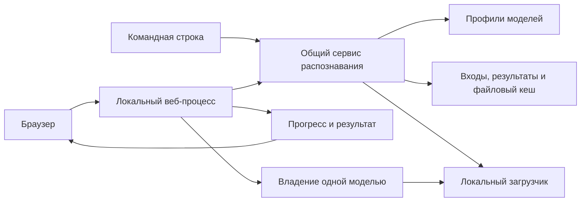

# Архитектура

Обзор показывает компоненты, их ответственность и потоки. Условия поведения задают
[контракт распознавания](../specs/image-ocr/spec.md) и [контракт веб-интерфейса](../specs/local-web/spec.md).
Причины крупных выборов находятся в [ADR](ADR/README.md).

Схема взаимодействия компонентов.

| Компонент | Ответственность |
|-----------|-----------------|
| Командная строка | Параметры запуска и представление результата |
| Веб-процесс | Копия входа, последовательная операция, прогресс и владение моделью |
| Общий сервис | Распознавание, проверка пригодности результата и сохранение |
| Профили | Согласованные настройки модели для обоих интерфейсов |
| Файловое хранение | Входы, текст и сведения для повторного использования результата |
| Загрузчик | Доступ к локальным весам и размещение на устройстве |

Интерфейсы зависят от общего сервиса; сервис не зависит от пользовательских оболочек.
Пригодность сохранённого результата относится к сервису, владение загруженными весами — к веб-процессу.
Параметры, числовые пределы и ограничения безопасности читаются у владельцев контрактов,
а конкретные компоненты и проверки — в [примерах](examples/README.md).
